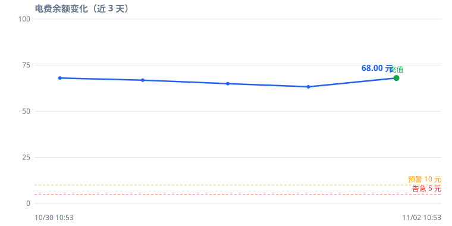
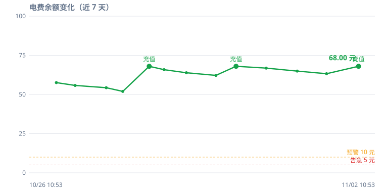
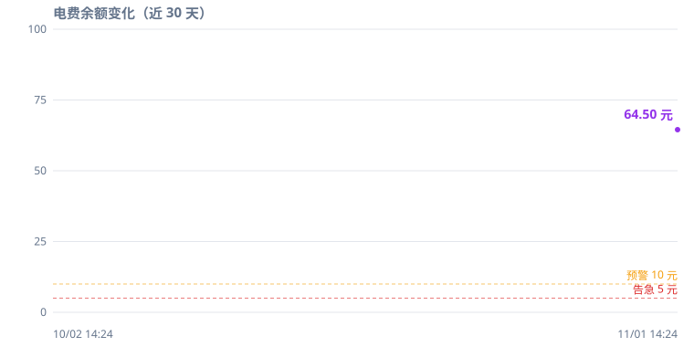

# 齐鲁工业大学 电费查询 / 监控 / 预警

> 纯 Node 实现的电费余额查询工具，**不需要浏览器**。
> 基于对 `qlgydx.mp.sinojy.cn`（智慧财务）接口的逆向分析，由 GitHub Actions 定时查询，
> 余额过低时通过 [ntfy](https://ntfy.sh/) 推送到手机。

## 📈 电费余额趋势（自动更新）

每次定时查询后由 GitHub Actions 自动重画。蓝色折线，每个数据点标注余额数值；绿色圆点 = 充值；橙色/红色虚线 = 预警/告急阈值。

### 近 3 天



### 近 7 天



### 近 30 天



> 上面三张图是**示例数据**，用来演示图表长什么样。你 Fork 或基于模板建仓之后，
> 第一次定时查询跑完，Actions 就会用你自己的真实余额重画这三张图。

---

## 这是什么

学校宿舍的电费余额只能登录智慧财务网站手动查，而且每次都要走一遍统一身份认证。
这个项目把那条链路抽出来做成命令行工具，再交给 GitHub Actions 定时跑：

| 你会得到 | 说明 |
|---|---|
| 余额自动查询 | 每 2 小时一次（8:00–24:00），凌晨不查 |
| 手机预警推送 | 余额低于阈值 → ntfy 推送到锁屏 |
| 余额趋势图 | 3 / 7 / 30 天折线，自动标注充值点 |
| 完全免费 | GitHub Actions 免费额度约 2000 分钟/月，本项目只用 ~160 分钟 |

**不做的事**：不提供用电量明细（接口没有）、不做自动充值（接口不支持）。

---

## 实现原理

整套链路要过四道关，任何一道错了都拿不到余额。

### 1. 登录：SM2 加密 + 时间戳

`POST https://sso.mp.sinojy.cn/oauth2.0/loginSubmit`

```
明文  = 账号 + "|" + 13 位毫秒时间戳
中间  = base64(明文)
密文  = "04" + SM2(中间, 学校公钥, C1C3C2)      // 266 位 hex
```

账号和密码**各自**这样加密一次，作为 `userName` / `pwd` 提交。
公钥是前端 JS 里硬编码的，逆向时直接抠出来。

### 2. 换 SESSION：两步走，第一步不能跟随跳转

1. `GET /oauth2.0/authorize` —— **必须 `followRedirects=false`**，从 302 响应的
   `Location` 头里抠出 `code` 参数
2. `GET /api/user/ssoRedirect.do?code=<code>` —— 这一步的响应才 `Set-Cookie` 下
   `SESSION`

漏了"不跟随跳转"，拿到的是最终页面而不是 `code`，后面全崩。

### 3. 拿 sessionToken：body 必须带 domain

`POST /api/pageService/firstInterFace`，body 里必须有 `domain` 字段，
返回的 `sessionToken` 是后续所有 `/api/` 请求的凭据。

### 4. 验签：每个 /api/ 请求都要带 token

```
token = MD5( salt + MD5( rand.slice(-6) + MD5(JSON.stringify(body)) ) )
```

- `salt = "hgf434h767s3r56f"`（前端硬编码）
- `rand` 是 13 位小写字母数字随机串
- 注意嵌套顺序：**最内层是 body 的 MD5**

`requestid` 服务端不校验，随便填。

### 5. 查余额：从嵌套 JSON 里挖

`POST /api/rechargeMobileService/selectAndCheckOrder`

```json
{ "merchantId": 111267, "userInfoId": <个人 id>, "rechMerMapId": 338,
  "custRechNo": "示例园#1#A101" }
```

成功码 `30300000`，余额藏在 `datajson.deviceInfo[0].infos[]` 里
`key === "JC_remoney"` 那条的 `keyValue`。

### 两个绕不过去的坑

**登录熔断**：学校 SSO 密码连错 3 次就进验证码状态（此后正确密码也登不上，
约 86 秒恢复），而且**锁定按账号不按 IP**，换网络没用。所以程序识别到登录失败
立刻停手熔断，记下"下次最早尝试时间"，绝不自作聪明重试——否则定时任务会把账号反复锁死。

**DoH 兜底**：学校 DNS 对云厂商 IP 段会返回不可达地址（实测 `43.224.184.x`、
`45.116.154.x` 两组全超时）。程序在 connect timeout 时改用阿里 DoH
（`dns.alidns.com`）重新解析，用 undici Agent 锁定 IP 重试。

---

## ntfy 使用流程

ntfy 是一个开源的推送服务，**不用注册、不用装 SDK、国内可直连**，
发一条 HTTP POST 就能让手机弹通知。

### 工作原理

```
程序  --POST-->  https://ntfy.sh/<topic>  --推送-->  手机 ntfy App
```

`<topic>` 就是你随便起的一个字符串，相当于频道名。谁订阅了同名 topic
谁就能收到——所以**起个别人猜不到的**，别用 `test` / `elec` 这种。

### 三步配好

**第 1 步：手机装 App**

- Android：[Play Store](https://play.google.com/store/apps/details?id=io.heckel.ntfy) / [F-Droid](https://f-droid.org/packages/io.heckel.ntfy/)
- iOS：App Store 搜 ntfy

**第 2 步：订阅 topic**

打开 App → 右下角 `+` → 输入你选的 topic（比如 `my-elec-topic-9f3k`）→ Subscribe。

**第 3 步：告诉程序这个 topic**

在仓库 Settings → Secrets and variables → Actions 里加一条：

```
QLGYDX_NTFY_TOPIC = my-elec-topic-9f3k
```

本地跑的话就写进 `config.json`：

```json
{ "alert": { "notify": { "ntfy": {
  "server": "https://ntfy.sh",
  "topic": "my-elec-topic-9f3k"
} } } }
```

配好后可以立刻验证一次：

```bash
node bin/elec.js alert-test
```

手机会收到一条 `🔴 预警测试`——收到了就说明链路通了。

### 你会收到哪些消息

| 标题 | 优先级 | 触发条件 |
|---|---|---|
| 🔴 电费余额严重不足 | 5（持续响铃） | 余额 < 5 元 |
| 🟠 电费余额偏低 | 5（持续响铃） | 余额 < 10 元 |
| 🟠 电费消耗异常 | 5 | 24 小时内余额下降 ≥ 40% |
| 🟠 电费查询失败 | 5 | 连续查询失败 |
| 🟢 电费余额已恢复 | 3（安静） | 充值后回到阈值以上 |
| 🟢 电费日报 | 3（安静） | 每次查询成功后 |

同一类预警有冷却时间（默认 180 分钟），不会一直轰炸；
但严重不足状态下每 12 小时会重复提醒一次，避免你忽略。

> **为什么标题是中文还能正常显示**：HTTP header 不能直接放中文，
> 程序用 RFC 2047（`=?UTF-8?B?base64?=`）编码后再发，手机端会自动解码。

### 换别的推送渠道

ntfy 最省事，但不是唯一选择。`config.json` 的 `alert.notify` 里还支持
PushPlus、Server酱、企业微信机器人、Bark、Telegram——配哪个用哪个，
也可以同时配多个（会同时发）。

---

## 拿到这个仓库后如何自己跑起来

这个仓库本身就是一份模板：**换成你的账号密码和宿舍号就能用**。

### 前置条件

- 一个 GitHub 账号
- Node.js **22 或以上**（本地跑需要；只走 Actions 的话不用装）
- 手机装好 ntfy（想收推送的话）

### 方式一：从模板生成自己的仓库，配 Secrets（推荐，零代码）

**1. 复制成你自己的仓库**

拿到这份代码有两种途径，看你从哪来的：

| 情况 | 怎么做 |
|---|---|
| 作者把仓库设成了 **Template repository** | 仓库页右上角绿色的 **`Use this template`** → `Create a new repository`，起个名字，创建即可 |
| 没设成模板（普通仓库） | 点右上角 **Fork** |

两条路都建议顺手把新仓库改成私有：`Settings` → `General` → 最下面
`Danger Zone` → `Change repository visibility` → **Private**。
你的学号、宿舍号、余额都会出现在提交记录和图表里，别公开。

> 私有仓库照样能跑 `schedule`，只是消耗 Actions 免费额度（2000 分钟/月）。
> 本项目每 2 小时一次、8–24 点，约 160 分钟/月，离上限很远。

> 模板和 Fork 的区别：模板生成的新仓库**历史是干净的**（不含作者的电费数据），
> Fork 会保留作者的提交历史和数据分支。要干净就选模板；仓库没设成模板就 Fork 后
> 自己删掉 `data` 分支。

**2. 找到你的电表号**

有两种办法，任选：

- 网页上查：登录智慧财务 → 充值缴费页面，能看到形如 `示例园#1#A101` 的编号
- 让程序自己找：本地跑下面「方式二」的第 2 步，会自动列出来

**3. 配 Secrets**

仓库页 → Settings → Secrets and variables → Actions → `New repository secret`，
加这三条必填：

| Name | Value |
|---|---|
| `QLGYDX_USER` | 你的学号（12 位数字） |
| `QLGYDX_PASS` | 你的统一身份认证密码（原样抄） |
| `QLGYDX_METER` | 电表号，如 `示例园#1#A101` |

想收推送再加一条：

| Name | Value |
|---|---|
| `QLGYDX_NTFY_TOPIC` | 上面 ntfy 里选的 topic |

**4. 手动跑一次验证**

Actions 页 → 左侧「电费查询」→ 右侧 `Run workflow` → 把 `force` 勾上 → Run。

跑完后点进这次 run，看「执行查询」这一步的日志，应该能看到：

```
INFO  没有可用会话，需要登录…
INFO  登录成功（张三）
INFO  余额 68.30 元  (示例校区-示例园1A101)
INFO  🟢 电费日报
```

同时手机收到一条日报推送。

**5. 之后就不用管了**

`schedule` 会自动按 8:00–24:00 每 2 小时跑一次。README 顶部的三张折线图
也会随每次查询自动更新。

### 方式二：本地跑通再上云（出问题好排查）

**1. 克隆并装依赖**

```bash
git clone https://github.com/<你的用户名>/<仓库名>.git
cd <仓库名>
npm install
npm test          # 应该看到 88 pass
```

**2. 一条命令完成配置**

```bash
node bin/elec.js setup --user 你的学号 --pass "你的密码"
```

这条命令会登录一次、自动发现你名下绑定的宿舍，把账号密码和电表号写进
`config.json`。如果你有多间宿舍，用 `--meter` 指定：

```bash
node bin/elec.js setup --user 你的学号 --pass "你的密码" --meter "示例园#1#A101"
```

> 密码里有 `$`、`!` 这类特殊字符时，**一定要用引号包起来**，
> 否则 shell 会先解释掉。

**3. 查一次试试**

```bash
node bin/elec.js query
```

```
余额：68.30 元
位置：示例校区学生公寓.示例园1号公寓A区.3楼.A101
```

**4. 测一下推送**

```bash
QLGYDX_NTFY_TOPIC=你的topic node bin/elec.js alert-test
```

**5. 常驻运行（可选）**

不想用 GitHub Actions 的话，`watch` 可以跑在任何常开机器上：

```bash
node bin/elec.js watch
```

它会按 `config.json` 里的间隔自己循环查。开机自启的配法见
[ntfy-relay.md](docs/ntfy-relay.md)。

### 常用命令

| 命令 | 作用 |
|---|---|
| `node bin/elec.js setup` | 首次配置：登录 + 自动发现宿舍 + 写 config.json |
| `node bin/elec.js query` | 查一次余额 |
| `node bin/elec.js accounts` | 列出账号下所有绑定的宿舍 |
| `node bin/elec.js check` | 查询 + 判预警 + 发通知（Actions 跑的就是这个） |
| `node bin/elec.js watch` | 常驻定时监控 |
| `node bin/elec.js history` | 看历史记录 |
| `node bin/elec.js alert-test` | 发一条测试推送 |
| `npm test` | 跑单元测试 |

### 改默认行为

`config.json` 里最常改的几个：

```json
{
  "schedule": {
    "intervalMinutes": 120,     // 查询间隔（分钟）
    "activeHours": [8, 24]      // 只在这个时段内查询，凌晨不查
  },
  "alert": {
    "threshold": 10,            // 余额低于这个值 → 预警
    "criticalThreshold": 5,     // 低于这个值 → 严重预警
    "dailyChangePercent": 40    // 24 小时跌超这个百分比 → 消耗异常
  }
}
```

改完本地生效；走 Actions 的话记得同步改 workflow 里的 `cron`。

### 万一你想把仓库改成公开

跑起来之后仓库里就有你的真实数据了：`data` 分支存着余额曲线和 `history.jsonl`，
`docs/charts/*.svg` 里也有你的宿舍编号，提交记录里还有你填过的宿舍号。

公开前**务必**打开脱敏开关：

```
QLGYDX_REDACT = 1
```

设了之后：房号打码成 `***`、不再发布历史数据和图表，
`scripts/check-snapshot.js` 会在发布前校验，没打码就直接让任务失败。

另外手动清一下历史残留——**脱敏开关不会追溯已发布的内容**：

```bash
git push origin --delete data      # 删掉整个 data 分支
rm -rf docs/charts/*.svg           # 删掉已生成的图
git commit -am "清空历史图表" && git push
```

> 最省事的做法还是保持私有：私有仓库照样能跑 `schedule`，额度也够用。

---

## 注意事项

- 站点在 23:45–00:00 维护，凌晨时段不查询
- 接口只提供余额，无用电量/消费流水；消耗速率与预测靠本地历史推算
- 请合理设置查询间隔，避免对学校服务器造成压力

---

## 相关文档

- 完整部署清单：[docs/DEPLOY.md](docs/DEPLOY.md)
- Actions 方案详解与常见问题：[docs/github-actions.md](docs/github-actions.md)
- 自带常开机器时的替代方案：[docs/ntfy-relay.md](docs/ntfy-relay.md)
